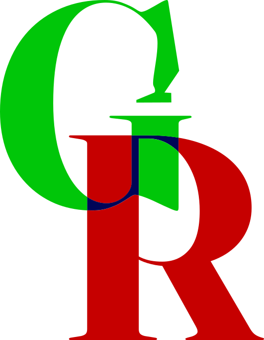

# GeoReforge

 <strong>Transformez des référentiels géographiques en zones métier exploitables.</strong><br clear="left">

Français | [English](README.md)

[](https://www.python.org/)
[](https://flask.palletsprojects.com/)
[](https://www.sqlalchemy.org/)
[](https://gunicorn.org/)
[](https://www.sqlite.org/)
[](https://www.docker.com/)

GeoReforge est un moteur open source conçu pour construire, transformer et versionner des zones géographiques métier à partir de référentiels géographiques publics.

De nombreuses décisions réglementaires, fiscales, administratives, logistiques ou commerciales dépendent de la géographie. Une organisation peut avoir besoin de savoir où un produit peut être commercialisé, quelles réglementations s'appliquent à un territoire, ou comment définir et réutiliser une zone métier dans plusieurs applications.

Les référentiels géographiques fournissent des pays, des régions et des frontières administratives, mais rarement les zones métier propres aux besoins des organisations. GeoReforge vise à combler cet écart.

## Index

- [GeoReforge](#georeforge)
  - [Index](#index)
  - [Principe](#principe)
  - [Philosophie](#philosophie)
  - [Cas d'usage](#cas-dusage)
    - [Réglementation](#réglementation)
    - [Fiscalité](#fiscalité)
    - [Logistique](#logistique)
    - [Analyse métier](#analyse-métier)
    - [Data Engineering](#data-engineering)
  - [Fonctionnalités visées](#fonctionnalités-visées)
    - [Référentiels géographiques](#référentiels-géographiques)
    - [Construction de zones](#construction-de-zones)
    - [Versionnement et reproductibilité](#versionnement-et-reproductibilité)
    - [Export](#export)
    - [API et interface Web](#api-et-interface-web)
  - [Architecture](#architecture)
  - [Objectifs du projet](#objectifs-du-projet)
  - [Public visé](#public-visé)
  - [Utilisation](#utilisation)
    - [Assistant local de configuration](#assistant-local-de-configuration)
    - [RUN](#run)
    - [BUILD](#build)
    - [Intégration dans un compose](#intégration-dans-un-compose)
  - [Gestion des accès](#gestion-des-accès)

## Principe

À partir de référentiels géographiques tels que [Natural Earth](https://www.naturalearthdata.com/), [GADM](https://gadm.org/) ou [geoBoundaries](https://www.geoboundaries.org/), GeoReforge vise à permettre la composition de nouvelles zones à partir de territoires existants.

Par exemple, une zone peut être définie comme l'union de la Belgique, des Pays-Bas et du Luxembourg :

```text
Belgique + Pays-Bas + Luxembourg = Benelux
```

Une zone personnalisée peut aussi être construite en retirant des territoires de l'Europe :

```text
Europe - Suisse - Royaume-Uni = Zone personnalisée
```

Les zones générées ont vocation à devenir des objets géographiques réutilisables dans d'autres projets et systèmes.

## Philosophie

GeoReforge ne se limite pas au stockage de géométries. Le projet vise à permettre de :

- décrire la construction d'une zone ;
- versionner sa définition ;
- reproduire sa génération ;
- exporter le résultat dans différents formats ;
- le réutiliser dans des systèmes tiers.

Une zone métier peut être décrite par des règles, par exemple :

```yaml
zone:
  code: BENELUX
  name: Benelux
  from: 2026-01-01
  to: 2026-12-31

operations:
  - union:
      - belgium
      - netherlands
      - luxembourg
```

Conservée dans Git, cette définition peut être auditée, examinée et régénérée au fil du temps.

## Cas d'usage

### Réglementation

Associer des réglementations à des zones géographiques et déterminer les règles applicables à un produit ou à l'un de ses composants sur un territoire donné.

```text
Produit -> Composants -> Réglementations -> Zones -> Territoire du client
```

### Fiscalité

Déterminer les règles fiscales applicables en fonction d'un territoire.

### Logistique

Construire des zones de distribution et d'approvisionnement adaptées aux besoins opérationnels.

### Analyse métier

Créer des regroupements géographiques adaptés à une activité spécifique.

### Data Engineering

Construire et maintenir des référentiels enrichissant les données opérationnelles.

## Fonctionnalités visées

Les capacités ci-dessous décrivent les objectifs du projet ; elles ne signifient pas que toutes les fonctionnalités sont déjà implémentées.

### Référentiels géographiques

- continents et pays ;
- régions administratives ;
- subdivisions territoriales.

### Construction de zones

- unions, différences et intersections de territoires ;
- zones imbriquées ;
- zones composites.

### Versionnement et reproductibilité

- définitions au format YAML (ou peut-être TOML) ;
- génération reproductible ;
- historique des modifications.

### Export

- GeoJSON ;
- Shapefile ;
- GeoPackage ;
- PostgreSQL/PostGIS ;
- SQLite/SpatiaLite.

### API et interface Web

- générer et consulter des zones ;
- explorer les référentiels géographiques ;
- prévisualiser les zones sur une carte et télécharger les artefacts générés ;
- créer des zones visuellement et automatiser les intégrations.

## Architecture

[Architecture détaillée](doc/Architecture.fr.md)

```text
Référentiels géographiques
             |
             v
       GeoReforge <---- Définitions de zones versionnées
             |
             v
      Génération des zones
             |
             v
       Formats de sortie
             |
             v
    Outils SIG, API et bases de données
```

## Objectifs du projet

- Simplifier la création de référentiels géographiques métier.
- Fournir un moteur de génération reproductible et automatisable.
- Faciliter l'enrichissement des données par le contexte géographique.
- Réduire la duplication des définitions géographiques entre applications.
- Permettre une utilisation aussi bien en local qu'en production.

## Public visé

- Data Engineers et Data Analysts ;
- équipes SIG ;
- architectes de données ;
- consultants métiers ;
- éditeurs de logiciels ;
- projets open source.

**GeoReforge ne cherche pas à remplacer les référentiels géographiques existants. Son objectif est de les transformer en référentiels métier exploitables et maintenables par les organisations.**

## Utilisation

Pour utiliser GeoReforge, plusieurs cas de figure sont à envisager.

Pour utiliser une base externe, consultez le [guide de préparation des bases de données](doc/DbPrepare.fr.md).

Pour définir les zones à télécharger, montez en volume le fichier de configuration `zones.toml` dans le conteneur à l'emplacement `/etc/app/zones.toml` de la manière suivante :

```sh
docker run --rm -v $(pwd)/database:/var/lib/app -v $(pwd)/zones.toml:/etc/app/zones.toml georeforge:latest
```

Pour créer le fichier `zones.toml`, suivez le guide [zones.toml](doc/Zones.fr.md).

### Assistant local de configuration

Une interface en terminal permet de sélectionner les jeux Natural Earth, d’explorer un SHP à la demande, de définir les mappings et de préparer `zones.toml`. Ses dépendances restent séparées de celles de l’API et de l’image Docker :

```sh
python3.14 -m venv .venv-zones
. .venv-zones/bin/activate
python -m pip install -r scripts/zones_maker/requirements.txt
PYTHONPATH=scripts python -m zones_maker.main
```

Le téléchargement d’un jeu n’a lieu que lors de son exploration et uniquement si le SHP choisi n’est pas déjà présent dans `tmp/`.

### RUN

Pour exécuter GeoReforge en utilisant Docker, vous pouvez utiliser la commande suivante :

```sh
docker run --rm -v $(pwd)/database:/var/lib/app georeforge:latest
```

Vous avez alors une instance GeoReforge en local et la base de données est persistée dans le répertoire `database` de votre machine.

Vous avez aussi possibilité de monter en volume le fichier de configuration `config.py` ou le fichier d'environnement `env.conf` de la manière suivante :

```sh
docker run --rm -v $(pwd)/database:/var/lib/app -v $(pwd)/config.py:/etc/app/config.py -v $(pwd)/env.conf:/etc/app/env.conf georeforge:latest
```

Vous avez toutefois possibilité d'utiliser un utilisateur spécifique pour exécuter l'image Docker en ajoutant l'option `--user $(id -u):$(id -g)` à la commande `docker run`.

### BUILD

Si vous souhaitez utiliser un ID utilisateur et un ID de groupe spécifiques pour l'utilisateur `appuser` dans le conteneur, vous pouvez passer les arguments `UID` et `GID` lors de la construction de l'image Docker :

```sh
docker build -f src/dockerfile.api --build-arg UID=$(id -u) --build-arg GID=$(id -g) -t georeforge:latest .
```

Vous pouvez ensuite exécuter l'image construite avec la commande `docker run` comme décrit dans la section RUN.

### Interface Web

L'image compile automatiquement les modules SCSS avec Sass et embarque HTMX, GSAP, Leaflet, les icônes et les polices. Le contexte de construction est la racine du dépôt. En développement local :

```sh
npm ci
npm run build
PYTHONPATH=src .venv/bin/flask --app api.main run --host 127.0.0.1 --port 5000
```

La base indiquée par `DB_PATH` doit déjà être initialisée. Le premier accès à `/` ouvre les préférences : navigation A (onglets) ou C (espace cartographique), et thème système, clair ou sombre. Ces choix sont conservés en base par identité. Le mode sans authentification partage les préférences de l'identité locale.

Les catalogues regroupent les versions d'un même code. Le constructeur applique les opérations dans l'ordre : union, différence, intersection, différence symétrique (`EXCLUDE`). L'export PostGIS fournit un fichier SQL, sans connexion à une base distante. Les exports YAML référencent les identifiants des sources : leur réimport nécessite ces mêmes sources.

L'import TOML prépare les ajouts Natural Earth dans un aperçu valable 30 minutes avant validation. Il ne supprime aucune source. La suppression utilise exclusivement la sélection du tableau et une confirmation ; une source utilisée par une version reste protégée. Un import volumineux peut nécessiter d'augmenter le délai Gunicorn/proxy, les téléchargements étant synchrones.

Les pages et fragments sont filtrés par Jinja avec `data-capability`, et chaque route vérifie les droits. L'administration permet de consulter les comptes et de débloquer les connexions. Les tests d'interface s'exécutent avec `PYTHONPATH=src .venv/bin/python -m pytest tests/test_front.py`.

### Intégration dans un compose

Vous pouvez intégrer GeoReforge dans un fichier `docker-compose.yaml` de la manière suivante :

```yaml
services:
  georeforge:
    image: georeforge:latest
    volumes:
      - ./database:/var/lib/app
      - ./config.py:/etc/app/config.py
      - ./env.conf:/etc/app/env.conf
    environment:
      DB_PASSWORD: ${DB_PASSWORD}
      DB_USER: ${DB_USER}
      DB_NAME: ${DB_NAME}
      DB_SCHEMA: ${DB_SCHEMA}
      DB_HOST: ${DB_HOST}
      DB_PORT: ${DB_PORT}
```

Il vous faudra définir les variables d'environnement dans un fichier .env à la racine de votre projet ainsi que le fichier `config.py` suivant le modèle dans [config.py](./src/config.py).

## Gestion des accès

Par défaut, GeoReforge utilise un mode d'accès libre (`none`), ce qui signifie qu'aucune authentification n'est requise pour accéder à l'application et à l'ensemble de ses fonctionnalités.

Pour les autres cas, GeoReforge peut être configuré pour utiliser un mode d'accès interne (`internal`) ou externe (`external`). Vous trouverez plus de détails sur la configuration de ces modes dans la documentation dédiée à la [gestion des accès](./Users.fr.md) et à leur configuration.
