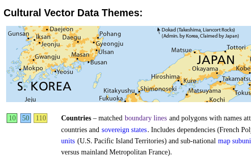
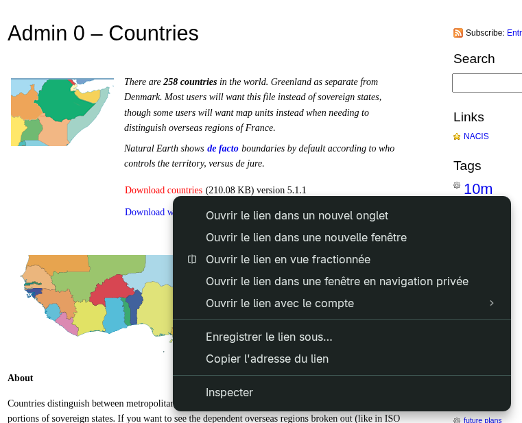
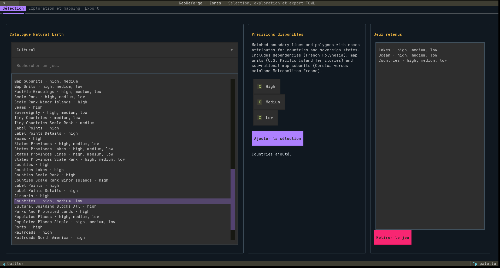
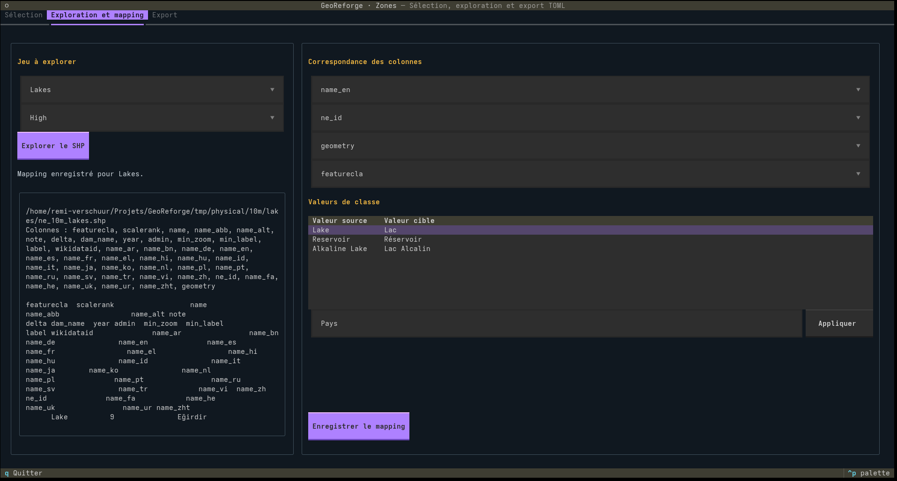
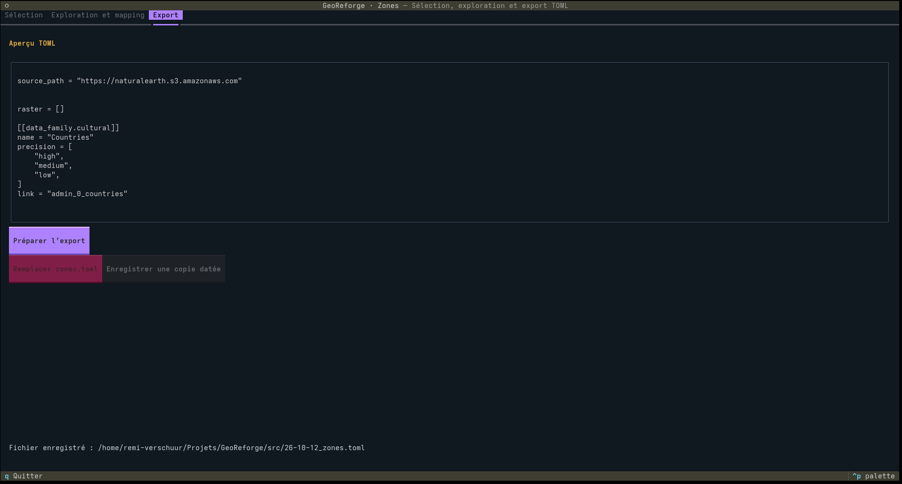
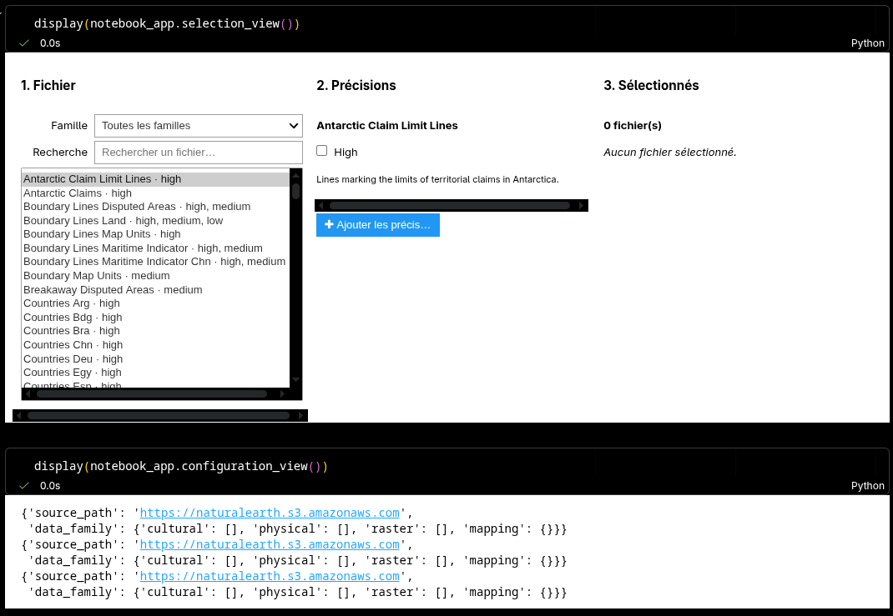

# Build a `zones.toml` file

The `zones.toml` file defines the Natural Earth datasets and resolutions used by GeoReforge. You can prepare it with either the Textual terminal interface or the Jupyter notebook; both use the same catalog and validation rules.

## Contents

- [The configuration file](#the-configuration-file)
- [Natural Earth identifiers](#natural-earth-identifiers)
- [Use the Textual TUI](#use-the-textual-tui)
- [Use the Jupyter notebook](#use-the-jupyter-notebook)
- [Export and output paths](#export-and-output-paths)

## The configuration file

The configuration groups datasets into three families: `cultural`, `physical`, and `raster`. Each entry has a display name, the available resolutions, and the last part of its Natural Earth download name.

```toml
source_path = "https://naturalearth.s3.amazonaws.com"

[[data_family.cultural]]
name = "Countries"
precision = ["low", "medium", "high"]
link = "admin_0_countries"

[[data_family.physical]]
name = "Oceans"
precision = ["low", "medium", "high"]
link = "ocean"
```

The repository's default configuration is `src/zones.toml`. The local assistant helps create a complete configuration, including the column and class mappings required by the API.

## Natural Earth identifiers

Visit the [Natural Earth features page](https://www.naturalearthdata.com/features/) to find a dataset and the resolutions it provides.



Natural Earth resolution numbers map to the configuration values as follows:

- `10m`: `high`
- `50m`: `medium`
- `110m`: `low`

Open the dataset page and copy the download link for a resolution.



For a filename such as `ne_110m_admin_0_countries.zip`, use `admin_0_countries` as the `link` and `low` as the `precision`. List only the resolutions you need. Repeat for each dataset you want to configure.

## Use the Textual TUI

From the repository root, create a dedicated environment and install the assistant dependencies:

```sh
python3.14 -m venv .venv-zones
source .venv-zones/bin/activate
python -m pip install -r scripts/zones_maker/requirements.txt
```

Start the full-screen interface:

```sh
PYTHONPATH=scripts python -m zones_maker.main
```

The assistant dependencies are separate from the API dependencies and are not added to the Docker image.

1. In **Sélection**, filter or search the catalog, select a dataset, check one or more available resolutions, then add it to the selection.

  

1. In **Exploration et mapping**, choose a selected dataset and resolution, then select **Explorer le SHP**. The assistant reads an existing file under `tmp/`; if it is missing, it downloads only the selected dataset and resolution. Map the name, code, geometry, and class columns. For each class shown in the table, enter a target value and apply it, then save the mapping. Export is blocked until required mappings and class values are valid.

  

1. In **Export**, review the TOML preview and select **Préparer l’export**. If the configured destination exists, choose whether to replace it or save a dated copy.

  

Press `q` or `Ctrl+C` to quit the TUI.

## Use the Jupyter notebook

The notebook provides the same catalog, selection, mapping, and export workflow with ipywidgets. Its dependencies are not installed by `scripts/zones_maker/requirements.txt`, so add the notebook kernel packages to the dedicated environment:

```sh
python3.14 -m venv .venv-zones
source .venv-zones/bin/activate
python -m pip install -r scripts/zones_maker/requirements.txt
python -m pip install ipykernel ipywidgets
```

Open [`explore_file.ipynb`](explore_file.ipynb) in VS Code or Jupyter, select the `.venv-zones` Python kernel, and run the cells from top to bottom. The notebook loads the local catalog and displays the selection, configuration, exploration/mapping, and export views.



Select a dataset and its resolutions before exploring it. Exploration reads the SHP from `tmp/` when available; otherwise it downloads the selected dataset and resolution. Review and save the column and class mappings before preparing the export. Opening the notebook and displaying its views does not itself download a dataset or save a TOML file.

## Export and output paths

Both interfaces default to `src/zones.toml`. Preparing the export writes to that path if it does not exist. If it already exists, the interface requires an explicit choice to replace it or save a dated copy. Dated copies use the format `YY-MM-DD_zones.toml` in the same directory as the configured destination; an existing dated filename is never overwritten.

The TUI accepts custom paths with `--catalog`, `--data`, and `--zones`:

```sh
PYTHONPATH=scripts python -m zones_maker.main \
  --catalog src/naturalearth.json \
  --data tmp \
  --zones src/zones.toml
```

The notebook paths are set in its initialization cell: the catalog is `src/naturalearth.json`, the data directory is `tmp`, and the output file is `src/zones.toml`. Change those paths there when using a different layout.

## Reimplanting Sources and YAML

At bootstrap, each dataset and precision from `zones.toml` is recorded as a `FileImport` manifest. It stores the base URL, data family, name, precision, link, and column/class mapping. Imported zones are linked to that manifest. A configuration already present in the database is reused without changing or duplicating its zones.

A zone-definition YAML embeds these manifests under `sources`. Each operation refers to the manifest alias and the source zone's code/name; the local SQL ID is not used by this format. During import, the manifest must exist in the database and the code/name match must be unique. Missing or ambiguous sources are rejected. Older YAML files that use only `source_id` are rejected because they do not identify a portable source. Full snapshots use a separate restoration format and still require their referenced sources in the target database.

This portability applies to zones created by the `zones.toml` bootstrap. The administrative TOML upload flow does not yet create a `FileImport` manifest; zones from that flow still use local IDs in their YAML definitions.

A manifest's identity is derived from its normalized configuration (URL, family, name, precision, link, and mapping), not the downloaded content. Natural Earth can replace an archive at the same URL without the application detecting the change; a fresh database may then receive different geometries. Downloaded archives are not retained. Reimplantation is therefore idempotent for a configuration already present in the same database, but it does not guarantee bit-for-bit reproduction of remote data over time.
